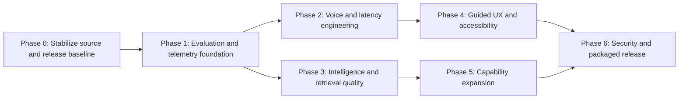

# Assistant Capability, Intelligence, Latency, and Release Roadmap

Updated August 6, 2026.

> **Execution outcome:** Implementation status and evidence for every roadmap
> work item are recorded in [ROADMAP_EXECUTION_REPORT.md](ROADMAP_EXECUTION_REPORT.md).
> All source-controlled and locally executable work is complete. Hardware,
> licensed speech-corpus, clean-machine, signing-certificate, and elapsed-time
> gates remain external acceptance gates and are not represented as passed.

## Purpose

This document turns the current-project audit into an executable improvement
program. It covers assistant capability, intelligence, retrieval, latency,
speech, user experience, security, release readiness, and maintainability.

The product already has a strong permission-gated execution core. The next
objective is to prove that it can understand varied requests, respond quickly on
the target hardware, recover clearly, and ship as a trustworthy Windows product.
Feature expansion should follow that evidence rather than run ahead of it.

## Program Outcomes

The program is complete when Local Assistant can demonstrate all of the
following on the supported Windows target:

1. Common deterministic commands remain fast, safe, and independent of the LLM.
2. Voice requests have measured activation, STT, planning, execution, and TTS
   latency with repeatable p50 and p95 results.
3. Planner quality is evaluated on broad goals, paraphrases, ambiguity,
   multi-turn references, retrieval, and result-dependent workflows rather than
   only simple structured calls.
4. Retrieved local or web facts have inspectable provenance and citations.
5. Cancellation stops the visible workflow quickly and releases provider work
   within a bounded interval.
6. The highest-value missing capabilities—local document understanding, file
   content search, safe visual understanding, and event-driven automation—are
   delivered as permission-scoped skills.
7. First-run setup takes a nontechnical user from installation to one successful
   typed command and one successful voice command.
8. The source tree, documentation, installer, and packaged executable represent
   the same tested release.
9. Hostile third-party native extensions cannot rely on Python subprocess and
   Job Object limits as their only security boundary.

## Scope and Non-Goals

This roadmap improves the existing architecture. It does not authorize a rewrite
or weaken the current safety model.

The following remain non-goals unless separately approved:

- raw model-generated shell execution;
- unsupervised general desktop control;
- implicit collection of screenshots, clipboard contents, private documents, or
  browser content;
- automatic permission grants or confirmation bypasses;
- silent migration from offline processing to cloud providers;
- accepting arbitrary marketplace native code before an OS-enforced sandbox is
  available.

## Starting Baseline

The August 6 audit established this pre-execution baseline. Current results are
in `ROADMAP_EXECUTION_REPORT.md`; the values below are intentionally preserved
to show what the roadmap changed.

| Area | Evidence | Current conclusion |
| --- | --- | --- |
| Regression suite | 1,106 tests passed | Strong automated baseline |
| Learning suite | 29 tests passed | Guided architecture examples remain green |
| Marked UI suite | 51 passed, 4 deselected | Useful offscreen coverage |
| Static checks | 11 Ruff errors; 77 files need formatting | Current working tree is not release-clean |
| Deterministic latency | About 25 ms median in the stored 100-run benchmark | Fast path is credible |
| Planner benchmark | Three simple structured-call cases | Not representative of planner intelligence |
| Voice benchmark | Microphone, STT, and TTS figures incomplete | Release claim remains blocked |
| Packaged acceptance | Several physical and Windows lifecycle lanes remain open | Release claim remains blocked |
| Extension isolation | Signed subprocesses and resource limits | Insufficient for hostile native code |
| Source structure | Several 3,000–6,000-line hotspots | Refactoring pressure is high |

This plan treats the safety architecture, typed skill protocol, permission
pipeline, durable scheduler, audit trail, and deterministic router as assets to
preserve.

## Planning Principles

1. Measure before optimizing.
2. Evaluate end-user task success, not only schema validity.
3. Keep deterministic controls deterministic.
4. Treat all model and retrieved text as untrusted data.
5. Make every new capability explicit, typed, permission-scoped, cancellable,
   observable, and testable offline.
6. Prefer additive contract changes and documented migrations.
7. Separate warm and cold performance results.
8. Keep privacy-safe metrics free of transcript, prompt, response, document, and
   credential content.
9. Require a release gate, not a source-code assertion, for hardware-dependent
   behavior.
10. Deliver capability expansion in thin end-to-end slices.

## Priority Definitions

| Priority | Meaning |
| --- | --- |
| P0 | Blocks trustworthy performance, intelligence, or release claims |
| P1 | Materially improves daily usefulness, reliability, or safety |
| P2 | Important expansion after P0/P1 foundations are stable |
| P3 | Exploratory or ecosystem work with no current release dependency |

## Program Dependency Map

Phase 2 and Phase 3 may proceed in parallel after Phase 1 produces stable
measurement contracts. Capability slices may begin earlier only when they do not
change planner evaluation or voice latency baselines.

## Success Scorecard

Initial thresholds are release targets, not claims about current behavior. Phase
1 must record the baseline and may tighten or relax a threshold with documented
evidence.

### Performance Targets

| Measure | Target |
| --- | --- |
| Listening indication | p95 under 100 ms |
| First partial transcript | p95 under 1.5 s after sufficient speech |
| Final transcript | p95 under 1.0 s after end of utterance |
| Deterministic routing | p95 under 100 ms |
| Safe local execution overhead | p95 under 500 ms, excluding requested work |
| Warm planner decision | Provisional p50 under 3 s and p95 under 6 s |
| Warm first TTS audio | p95 under 750 ms |
| Visible cancel acknowledgement | p95 under 100 ms |
| Provider work released after cancel | p95 under 1 s where provider APIs permit |
| Total resident memory | Under 12 GB on the 16 GB target |
| Sustained-use growth | No unbounded growth during the 24-hour soak |

Metrics must distinguish typed versus voice, deterministic versus planner,
warm versus cold, provider/model, CPU versus GPU, and success versus timeout or
cancellation.

### Intelligence Targets

| Measure | Initial release target |
| --- | --- |
| Deterministic command intent accuracy | At least 99% on the controlled corpus |
| Planner task success | At least 90% on supported, sufficiently specified goals |
| Correct clarification | At least 90% on deliberately ambiguous cases |
| Hallucinated or unregistered skill execution | 0 |
| Unauthorized execution | 0 |
| False success claim after failed action | 0 |
| Retrieval recall@8 | At least 90% on the labeled retrieval set |
| Cited grounded answers | 100% of factual claims derived from retrieved sources |
| Unsupported capability honesty | At least 99% on capability-boundary cases |
| Replanning loop-limit compliance | 100% |

### Speech Quality Targets

Phase 1 should establish corpus-specific thresholds. Initial goals are:

- quiet-speech mean word error rate at or below 8%;
- controlled-noise mean word error rate at or below 15%;
- at least 98% correct capture or safe clarification for sensitive targets;
- no action from silence, playback feedback, or an incomplete final transcript;
- consistent interruption during capture, transcription, planning, execution,
  and playback.

### Quality and Release Targets

- Ruff check and format checks pass.
- Regression, learning, UI, packaging, and migration suites pass in CI.
- No known schema-version disagreement across code and documentation.
- Coverage is reported for core packages; critical policy and execution modules
  maintain branch coverage targets selected in Phase 0.
- The packaged executable passes the clean-account acceptance suite.
- Executable and installer checksums match the tested artifacts.
- Public-distribution artifacts are Authenticode-signed.

## Workstream 0 — Source and Release Baseline

Objective: create one clean, reproducible baseline before performance and
intelligence behavior changes.

| ID | Priority | Work item | Acceptance evidence |
| --- | --- | --- | --- |
| STAB-01 | P0 | Finish or explicitly defer the current visualization slice | Scope is documented; tests and manual cases match the claimed state |
| STAB-02 | P0 | Resolve Ruff failures and format drift | `ruff check` and `ruff format --check` pass |
| STAB-03 | P0 | Synchronize database schema, test counts, feature status, and release documentation | Automated documentation consistency check passes |
| STAB-04 | P0 | Add CI for lint, format, regression, learning, UI, and package smoke lanes | Required checks run on every change |
| STAB-05 | P1 | Add pre-commit hooks or an equivalent local gate | Contributors can reproduce CI checks locally |
| STAB-06 | P1 | Record dependency and artifact inventories | Diagnostic bundle and release manifest contain versions and hashes |
| STAB-07 | P1 | Establish a release branch/tag and artifact naming policy | Source commit, executable, installer, and checksum file are traceable |

Exit gate A:

- clean static checks;
- current tests green;
- no undocumented feature state;
- CI required checks active;
- a reproducible baseline tag exists.

## Workstream 1 — Evaluation Foundation

Objective: replace anecdotal quality claims with repeatable, privacy-safe product
evaluation.

### 1.1 Intelligence Corpus

Create a versioned corpus with labeled expected outcomes. Do not include personal
transcripts or production secrets.

Required categories:

- deterministic commands and negative near-matches;
- broad goals and paraphrases;
- missing-target, missing-constraint, and ambiguous-reference clarification;
- recent-result, selected-item, and multi-turn references;
- explicit memory remember/list/update/forget behavior;
- skill retrieval using synonyms and low lexical overlap;
- local knowledge questions with expected sources;
- answer versus action classification;
- multi-step independent and dependent plans;
- result-dependent replanning;
- unavailable skill and unsupported-capability handling;
- malformed model output and repair attempts;
- prompt injection in user, knowledge, web, result, and playbook text;
- cancellation and timeouts at every stage;
- provider unavailable, offline lock, and degraded fallback behavior.

Every case should include:

- request and optional prior turns;
- enabled skills and permission state;
- expected disposition;
- expected or forbidden skill IDs;
- required arguments or argument constraints;
- expected clarification properties;
- allowed source references;
- maximum latency class;
- safety invariants;
- scorer type and explanation.

### 1.2 Model Evaluation Harness

| ID | Priority | Work item | Acceptance evidence |
| --- | --- | --- | --- |
| EVAL-01 | P0 | Run the real planner prompt, schemas, retrieval, and candidate skills in the harness | Results match production planner inputs |
| EVAL-02 | P0 | Add deterministic, rule-based, and semantic scorers | Each failure has a stable reason code |
| EVAL-03 | P0 | Report task success, clarification, arguments, unsupported claims, retries, and latency | Machine-readable JSON plus human summary |
| EVAL-04 | P1 | Add repeated runs and confidence intervals for nondeterministic providers | Model comparisons show variance |
| EVAL-05 | P1 | Add regression thresholds by category | CI blocks meaningful quality regressions |
| EVAL-06 | P1 | Store sanitized failed-case artifacts | Failures are reproducible without private content |

### 1.3 Speech Corpus

Build or license a local corpus covering:

- multiple speakers and accents;
- quiet, fan noise, music, television, and speaker echo;
- short commands, long dictation, numbers, dates, paths, app names, and device
  names;
- silence, clipped starts, interruptions, and false activations;
- low-confidence sensitive recipients, paths, amounts, and device targets.

Record microphone model, distance, room/noise condition, sample rate, expected
transcript, sensitive spans, and allowed normalization.

Exit gate B:

- intelligence and speech corpora are versioned;
- the production planner and STT providers run through the harness;
- baseline reports exist for the target hardware;
- regression thresholds are documented.

## Workstream 2 — Observability and Latency Measurement

Objective: make user-perceived latency visible without storing private content.

### 2.1 Stage Model

Add correlated timing spans for:

1. activation received;
2. listening indication published;
3. first audio block;
4. end of utterance detected;
5. first partial transcript;
6. final transcript;
7. deterministic routing;
8. retrieval refresh and query;
9. context collection;
10. model load, prompt evaluation, generation, and total;
11. policy preparation;
12. confirmation or permission wait;
13. execution;
14. first visible response;
15. TTS synthesis start;
16. first TTS audio;
17. speech completion;
18. full interaction completion.

Interactive wait time must be recorded separately from computation. Typed and
voice requests must not be merged into one untagged latency distribution.

| ID | Priority | Work item | Acceptance evidence |
| --- | --- | --- | --- |
| OBS-01 | P0 | Define typed stage names and dimensions | Contract and migration tests pass |
| OBS-02 | P0 | Instrument voice activation, STT, routing, planning, execution, and TTS | One trace reconstructs the complete interaction |
| OBS-03 | P0 | Separate compute, provider, user-wait, and playback durations | Dashboard summaries no longer mix them |
| OBS-04 | P1 | Add p50, p95, count, error, timeout, and cancellation summaries | Dashboard and benchmark reports agree |
| OBS-05 | P1 | Add memory, VRAM, model-residency, and queue-depth samples | Sustained tests can detect pressure and leaks |
| OBS-06 | P1 | Add privacy tests for metric labels and diagnostic exports | No prompt, transcript, path, URL query, or secret content appears |

Exit gate C:

- a voice interaction produces a complete stage timeline;
- typed and voice metrics are separated;
- benchmark and dashboard values use the same definitions;
- no private content enters metrics.

## Workstream 3 — Voice and Responsiveness

Objective: meet the documented latency budgets under real speech and model load.

### 3.1 Speech-to-Text

| ID | Priority | Work item | Acceptance evidence |
| --- | --- | --- | --- |
| STT-01 | P0 | Benchmark configured Whisper models on GPU and CPU | WER, real-time factor, load time, RAM, and VRAM report |
| STT-02 | P0 | Replace repeated full-utterance partial decoding with bounded incremental behavior | Partial cost does not grow quadratically with utterance length |
| STT-03 | P1 | Use separate partial and final decoding profiles | Partials are fast; finals retain accuracy |
| STT-04 | P1 | Add optional background warmup and visible load state | Cold and warm latency are reported separately |
| STT-05 | P1 | Improve native cancellation and cleanup | Provider work releases within its target bound |
| STT-06 | P1 | Calibrate VAD, pre-roll, silence, and echo suppression on the corpus | False-cut and false-activation rates meet thresholds |

### 3.2 Local Planner Runtime

| ID | Priority | Work item | Acceptance evidence |
| --- | --- | --- | --- |
| LLM-01 | P0 | Benchmark multiple hardware-appropriate instruction models with the real planner harness | Selected default has a documented quality/latency/resource tradeoff |
| LLM-02 | P1 | Tune context and output budgets by request class | No material quality loss; p95 improves |
| LLM-03 | P1 | Make warmup, keep-alive, and unload policy resource-aware | STT/LLM/TTS coexist within memory targets |
| LLM-04 | P1 | Add provider hard-stop support where available | Cancellation does not leave long-running generation consuming resources |
| LLM-05 | P2 | Evaluate separate lightweight routing and stronger planning models | Added complexity must produce measured benefit |

### 3.3 Text-to-Speech

| ID | Priority | Work item | Acceptance evidence |
| --- | --- | --- | --- |
| TTS-01 | P0 | Measure real first-audio and playback latency with a configured Piper voice | Warm and cold results published |
| TTS-02 | P1 | Stream or sentence-chunk synthesis and playback | First audio meets the 750 ms target |
| TTS-03 | P1 | Preserve phrase caching with bounded disk retention | Cache hit/miss and privacy tests pass |
| TTS-04 | P1 | Validate barge-in, output-device switching, echo, and repeated interruption | Physical acceptance matrix passes |
| TTS-05 | P2 | Add pronunciation dictionary management | Names, apps, and devices can be corrected by the user |

Exit gate D:

- target-hardware voice benchmarks meet agreed budgets;
- cancellation and barge-in pass repeatedly;
- no unbounded model-memory growth occurs;
- text-only fallback remains immediate and reliable.

## Workstream 4 — Intelligence, Retrieval, and Grounding

Objective: improve generalization and factual trust without expanding execution
authority.

### 4.1 Retrieval Quality and Scale

| ID | Priority | Work item | Acceptance evidence |
| --- | --- | --- | --- |
| RET-01 | P0 | Establish labeled retrieval relevance and recall tests | Baseline and target recall@k are reported |
| RET-02 | P1 | Select a true local embedding default after hardware benchmarking | Quality/latency/privacy tradeoff documented |
| RET-03 | P1 | Add persisted content/model signatures and incremental refresh | Unchanged indexes are not rebuilt after restart |
| RET-04 | P1 | Batch embedding work and move refresh off the foreground request | First planner request does not pay full indexing cost |
| RET-05 | P1 | Add namespace-specific score thresholds and empty/low-score behavior | Irrelevant items and playbooks do not dominate candidates |
| RET-06 | P1 | Replace Python full-table scoring when scale requires it | Search latency remains bounded at the documented corpus size |
| RET-07 | P1 | Report retrieval provenance in developer mode | Scores and sources are inspectable without private text |

### 4.2 Planner Generalization

| ID | Priority | Work item | Acceptance evidence |
| --- | --- | --- | --- |
| PLAN-01 | P0 | Measure exact-pattern dependence using paraphrase families | Quality is stable outside canonical wording |
| PLAN-02 | P1 | Generalize ambiguity and referent handling through contracts and examples | Correct clarification target is selected across paraphrases |
| PLAN-03 | P1 | Distinguish answer, inspect, act, and unsupported-capability requests | Unnecessary tool calls and false promises meet targets |
| PLAN-04 | P1 | Improve result-dependent replanning and completion detection | Multi-step scenario suite meets task-success target |
| PLAN-05 | P1 | Calibrate repair retries and timeout budgets | Invalid output fails clearly within the latency budget |
| PLAN-06 | P2 | Add optional plan-quality critique that cannot execute or expand skills | Measured benefit exceeds added latency |

### 4.3 Citations and Grounded Responses

Add an optional, additive response citation contract containing:

- stable source ID and display title;
- sanitized HTTPS URL or local knowledge reference;
- result/item ID and optional excerpt locator;
- retrieval namespace and score;
- sensitivity state;
- accessed timestamp for time-sensitive web results.

| ID | Priority | Work item | Acceptance evidence |
| --- | --- | --- | --- |
| GROUND-01 | P1 | Add citation contracts and UI rendering | Existing clients remain compatible |
| GROUND-02 | P1 | Require citations for retrieved factual claims | Grounded-answer suite reaches 100% citation coverage |
| GROUND-03 | P1 | Preserve source/result linkage across replanning | Final answer cites the observations actually used |
| GROUND-04 | P1 | Add stale-source and conflicting-source handling | Assistant identifies uncertainty instead of merging contradictions silently |
| GROUND-05 | P1 | Add citation privacy and URL-redaction tests | Sensitive values do not leak |

Exit gate E:

- supported planner scenarios meet the intelligence targets;
- low-score retrieval does not cause unrelated actions;
- grounded factual responses have inspectable sources;
- paraphrase families no longer depend on exact hard-coded wording for success.

## Workstream 5 — Capability Expansion

Objective: add the highest-value missing capabilities after measurement and
planner quality are trustworthy.

Each slice must include contracts, permissions, deterministic routing where
appropriate, planner examples, progress, cancellation, structured results,
response rendering, audit redaction, offline behavior, and tests.

### Slice 5A — Local Documents and File Contents

Priority: P1. Recommended first capability slice.

Deliver:

- permission-scoped content search in explicitly approved folders;
- bounded extraction for text, PDF, common office documents, CSV, and supported
  spreadsheet formats;
- document summary, comparison, action-item extraction, and cited local Q&A;
- source page/sheet/section locators where available;
- incremental indexing with deletion and modification detection;
- clear handling for encrypted, corrupt, huge, or unsupported files.

Do not silently ingest entire user folders. Separate filename search, metadata
inspection, content extraction, and persistent indexing permissions.

### Slice 5B — Visual Understanding and Screen Guidance

Priority: P1 after document extraction.

Deliver:

- OCR for explicitly attached or approved screenshots and scanned pages;
- bounded layout regions and accessible descriptions;
- chart explanation and comparison;
- error-dialog explanation;
- safe guidance overlays without automatic input;
- explicit session indicator, pause, and retention controls for live screen use.

Consequential clicks and typing remain foreground-only and use the existing
input-control permission and confirmation model.

### Slice 5C — Productivity Write Operations

Priority: P1/P2 by provider.

Candidate order:

1. Drive content download and explicit upload;
2. Outlook draft/send and calendar event changes;
3. OneDrive content transfer;
4. Slack message drafts and confirmed sends;
5. Notion page creation/update;
6. GitHub issue/comment and pull-request workflows.

Every provider requires a separate OAuth scope review, exact target presentation,
idempotency analysis, retry classification, and action-bound confirmation.

### Slice 5D — Event-Driven Automations

Priority: P1/P2.

Add typed triggers for:

- file creation/change in an approved folder;
- calendar event timing or change;
- application/process state;
- device/entity state;
- bounded web-page change monitoring.

Reuse the scheduler's frozen calls, leases, authorization, run budgets,
notifications, and drift checks. Event payloads must be typed observations, not
prompts interpreted at execution time.

### Slice 5E — Creative and Lifestyle Capabilities

Priority: P2/P3.

Only after the earlier slices are stable, evaluate image generation/editing,
maps and travel, shopping, financial summaries, focus coaching, and proactive
daily/weekly reviews. Each area needs its own privacy, network, source-quality,
and consequential-action review.

Exit gate F for each slice:

- the slice has an acceptance document and threat review;
- offline/degraded behavior is explicit;
- permissions and confirmations match data and action risk;
- end-to-end scenarios pass;
- UI and accessibility behavior is complete;
- packaged acceptance passes before the feature is marked implemented.

## Workstream 6 — User Experience and Accessibility

Objective: make the assistant understandable and recoverable for a nontechnical
user.

### 6.1 Guided Setup

Create a resumable first-run flow that:

1. explains offline mode and optional network features;
2. detects CPU, GPU, RAM, audio devices, and installed runtimes;
3. recommends and verifies STT, LLM, embedding, and TTS models;
4. tests the microphone and output device;
5. configures push-to-talk and optional activation;
6. explains permissions with safe examples;
7. runs a typed deterministic command;
8. runs a voice command;
9. shows how to cancel and use Emergency Stop;
10. saves progress and offers a diagnostic report if a step fails.

### 6.2 Recovery and Transparency

| ID | Priority | Work item | Acceptance evidence |
| --- | --- | --- | --- |
| UX-01 | P1 | Add a health-led recovery center | Common missing-model/audio/GPU failures have guided actions |
| UX-02 | P1 | Show concise interpretation, permission, confirmation, and result state | Users can tell what will happen and what happened |
| UX-03 | P1 | Distinguish unsupported, unavailable, denied, failed, and timed-out outcomes | No generic error for known states |
| UX-04 | P1 | Add source/citation inspection and copy controls | Grounded answers are verifiable |
| UX-05 | P1 | Add useful progress for model load, indexing, long plans, and downloads | No unexplained long-running state |

### 6.3 Accessibility

Complete keyboard-only navigation, focus order, screen-reader labels, high
contrast, large text, reduced motion, captions/text equivalence, non-color-only
status, and accessible confirmation controls. Test at common Windows scaling
levels and with the packaged executable.

Exit gate G:

- a clean nondeveloper account completes setup without editing files or using a
  terminal;
- all primary workflows are keyboard operable;
- errors provide an actionable recovery path;
- visual and spoken outputs have text equivalents.

## Workstream 7 — Security and Extension Isolation

Objective: preserve the current strong policy boundary while closing the native
extension gap.

| ID | Priority | Work item | Acceptance evidence |
| --- | --- | --- | --- |
| SEC-01 | P0 for public marketplace | Select an OS-enforced boundary such as AppContainer or Windows Sandbox | Threat-model decision and prototype |
| SEC-02 | P1 | Define which extension classes may run in-process, worker-only, sandboxed, or not at all | Loader enforces the classification |
| SEC-03 | P1 | Broker filesystem, network, process, and secret access through narrow host APIs | Sandbox has no direct authority beyond reviewed grants |
| SEC-04 | P1 | Add hostile-extension tests for escape, persistence, child processes, handles, and exfiltration | Security suite demonstrates containment assumptions |
| SEC-05 | P1 | Add dependency and package vulnerability scanning | CI produces reviewable reports |
| SEC-06 | P1 | Protect signing keys and document incident/revocation behavior | Release and marketplace runbooks complete |

Continue to treat signatures as publisher identity and integrity, not proof that
code is safe.

Exit gate H:

- arbitrary third-party native packages are either OS-contained or rejected;
- brokered access is audited and scoped;
- security tests and threat documentation match the shipping design.

## Workstream 8 — Architecture and Maintainability

Objective: reduce change risk in high-churn modules without disrupting product
delivery.

Recommended extractions:

- planner schemas and prompt builders;
- planner grounding, repair, and revision policies;
- orchestrator request lifecycle, continuation state, result selection, and
  speech lifecycle;
- desktop settings pages, model diagnostics, onboarding, and individual
  connection pages;
- benchmark report contracts and shared metric names.

| ID | Priority | Work item | Acceptance evidence |
| --- | --- | --- | --- |
| ARCH-01 | P1 | Add dependency-boundary tests before extraction | Existing public imports remain stable |
| ARCH-02 | P1 | Split planner by policy responsibility | Planner behavior suite remains unchanged |
| ARCH-03 | P1 | Split orchestrator state/lifecycle services | Cancellation and continuation tests remain green |
| ARCH-04 | P1 | Split desktop application pages into modules | UI tests and saved settings remain compatible |
| ARCH-05 | P1 | Add static type checking incrementally | Selected core packages pass in CI |
| ARCH-06 | P1 | Add coverage reporting and critical-module thresholds | Policy/execution gaps become visible |
| ARCH-07 | P2 | Add property-based tests for parsers, schedules, scopes, and persisted contracts | Generated edge cases remain deterministic |

Avoid mixing a large refactor with model, persistence, and UX behavior changes in
one pull request.

## Workstream 9 — Packaged Release and Operations

Objective: make the release claim match the artifact users install.

Required acceptance lanes:

- clean non-administrator install;
- upgrade from every supported schema/application version;
- settings, permissions, audit, schedules, models, and cache preservation;
- uninstall with keep/remove data and models options;
- startup at login and hide-to-tray behavior;
- physical microphone and speaker interaction;
- packaged image/audio/video codec matrix;
- Windows notification delivery and click-through;
- sleep/restart scheduler reconciliation;
- emergency stop during a live foreground and background job;
- 24-hour real-time soak;
- offline firewall-isolated core run;
- executable, installer, model, and extension signature verification.

| ID | Priority | Work item | Acceptance evidence |
| --- | --- | --- | --- |
| REL-01 | P0 | Rebuild executable and installer from the clean baseline | Artifacts identify the exact commit |
| REL-02 | P0 | Complete physical voice and device acceptance | Signed run log with hardware details |
| REL-03 | P0 | Complete packaged scheduler and notification acceptance | Sleep/restart/toast/startup lanes pass |
| REL-04 | P0 | Complete upgrade and uninstall matrix | No unsupported data loss or downgrade ambiguity |
| REL-05 | P0 for public release | Authenticode-sign executable and installer | Windows verifies publisher and integrity |
| REL-06 | P1 | Run the documented 24-hour soak | No unbounded resource or database growth |
| REL-07 | P1 | Produce an SBOM and release manifest | Dependencies, hashes, licenses, and artifacts traceable |

Exit gate I:

- all required automated and manual lanes pass;
- security and performance scorecards meet their thresholds;
- artifacts are signed, hashed, traceable, and documented;
- no current feature is claimed complete solely because source code exists.

## Test Strategy

Use a layered test model:

1. Contract tests for every persisted, provider, skill, event, response, and
   extension boundary.
2. Unit tests for parsing, normalization, scoring, routing, policy, recurrence,
   and response composition.
3. Integration tests using fake providers and temporary directories for all
   offline deterministic behavior.
4. Model evaluation tests using controlled local models and labeled corpora.
5. Recorded-audio tests for STT and activation.
6. Offscreen UI tests for state, accessibility properties, and rendering.
7. Packaged interactive tests for physical audio, codecs, notifications, focus,
   hotkeys, sleep/restart, and installers.
8. Adversarial security tests for prompt injection, permission bypass,
   filesystem escape, network exfiltration, malicious packages, and replay.
9. Sustained and contention tests for memory, database growth, scheduling, model
   lifecycle, and cancellation.

Every resolved defect should add the smallest reliable regression test at the
lowest layer that reproduces it. Hardware-only defects should add both a mocked
regression and a manual acceptance case.

## Delivery and Change Management

Use small, reviewable increments:

- one workstream issue ID or tightly related set per change;
- targeted tests during development and the full gate before merge;
- database changes include forward migrations and supported-version tests;
- contract additions remain optional when API-compatible;
- feature flags or settings protect incomplete provider-dependent behavior;
- performance changes include before/after reports from the same hardware and
  corpus;
- documentation and acceptance logs change with the feature, not later.

No phase should remain permanently open. Items that are intentionally deferred
must move to a later phase with a reason, owner role, and prerequisite.

## Owner Roles

One person may hold multiple roles, but each issue should have one accountable
owner role:

| Role | Responsibility |
| --- | --- |
| Program/architecture | Priorities, contracts, phase gates, compatibility |
| Intelligence | Planner, retrieval, evaluations, citations, models |
| Voice/performance | Audio, STT, TTS, latency, memory, target hardware |
| Platform/skills | Windows, documents, integrations, automations |
| Desktop UX | Onboarding, recovery, accessibility, visual presentation |
| Security/release | Threat model, sandbox, signing, installer, acceptance |
| Quality | CI, test strategy, coverage, benchmark reproducibility |

## Risk Register

| Risk | Impact | Mitigation |
| --- | --- | --- |
| Feature work changes the baseline during measurement | Invalid comparisons | Freeze corpus, commit, settings, and hardware metadata per run |
| A stronger model exceeds 6 GB VRAM or 16 GB RAM constraints | Voice and UI latency regress | Measure combined residency and support explicit placement/unload policy |
| True embeddings add foreground startup latency | First broad request feels slower | Persist signatures, batch, index in background, expose progress |
| Planner quality improves only on known phrases | Brittle intelligence | Use held-out paraphrase families and category-level CI thresholds |
| Citations expose private paths or URL credentials | Privacy breach | Typed sanitized provenance and redaction tests |
| Broader integrations create accidental side effects | User harm | Read/write scope separation, exact targets, idempotency, confirmations |
| Screen understanding captures sensitive content | Privacy breach | Explicit session, indicator, pause, bounded retention, separate permission |
| Large refactors destabilize safety behavior | Regression | Boundary tests first; extract without semantic changes |
| Marketplace signatures are mistaken for sandboxing | Native-code compromise | OS-enforced isolation or reject hostile code |
| Manual acceptance is postponed repeatedly | False release confidence | Treat physical lanes as blocking release gates |

## Recommended First Execution Tranche

The first tranche should create trustworthy measurement and a clean baseline
before adding new capability code.

### Tranche 1 — Baseline and CI

1. STAB-01: resolve visualization scope and manual acceptance status.
2. STAB-02: make Ruff and formatting checks green.
3. STAB-03: fix schema/test-count/documentation drift.
4. STAB-04: add required CI lanes.
5. REL-01: build artifacts from the resulting baseline.

### Tranche 2 — Evaluation and Metrics

1. EVAL-01 through EVAL-03: production-realistic planner harness and report.
2. Build the first 100 planner cases, including held-out paraphrases.
3. OBS-01 through OBS-03: full interaction stage model.
4. Run the current 3B model and deterministic router against the new corpus.
5. Publish the baseline without tuning against the held-out set.

### Tranche 3 — Highest-Leverage Improvements

Choose work from measured bottlenecks:

- if end-of-utterance to final transcript dominates, start STT-02/03;
- if cold model load dominates, start STT-04 and LLM-03;
- if planner failures are retrieval-driven, start RET-03/04/05;
- if planner failures are reasoning-driven, start LLM-01 and PLAN-02/03;
- if first audio dominates, start TTS-01/02;
- if cancellation leaves work active, start STT-05 and LLM-04.

Do not select optimization work solely from intuition once Phase 1 metrics are
available.

## Suggested Program Cadence

These are planning bands, not delivery promises:

| Phase | Expected focused effort |
| --- | --- |
| Phase 0: stabilization | 1–2 weeks |
| Phase 1: evaluation and telemetry | 2–4 weeks |
| Phase 2: voice and latency | 3–6 weeks |
| Phase 3: intelligence and grounding | 4–8 weeks |
| Each capability slice | 4–8 weeks depending on formats/providers |
| UX/accessibility completion | 3–6 weeks, overlapping capability slices |
| Security and final packaged release | 3–6 weeks after feature freeze |

Review the scorecard weekly, phase gates at completion, and roadmap priorities
after every measured baseline. Keep one release-blocking phase and at most two
parallel improvement workstreams active at a time.

## Definition of Program Done

The roadmap is complete when:

- gates A through I pass;
- the intelligence, speech, performance, quality, and security scorecards meet
  their approved thresholds;
- the highest-value capability slices selected for the release are packaged and
  accepted;
- unsupported areas are documented honestly;
- the clean source commit, documentation, executable, installer, checksums, and
  signatures all describe the same build;
- a nontechnical user can install, configure, use, interrupt, verify, and recover
  the assistant on a supported Windows computer.
