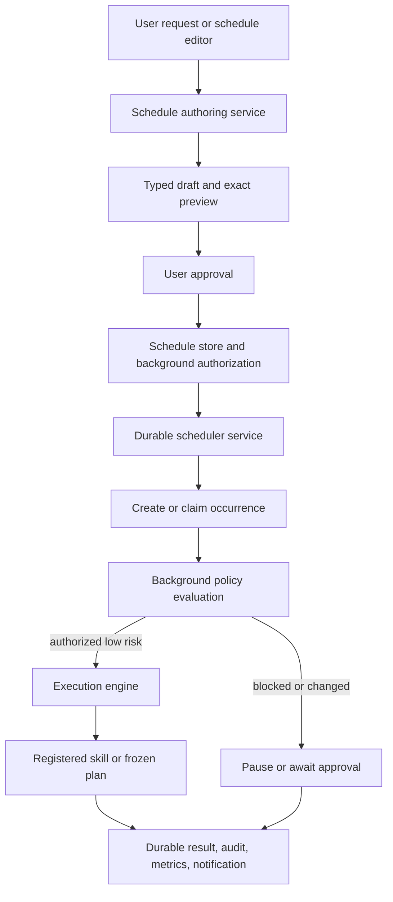

# Durable Scheduling and Bounded Background Autonomy Plan

Updated July 14, 2026.

## Status

Implemented through Phase 5 in source and automated tests. Durable reminders,
recurrence, schedule management, schedule-scoped fixed/frozen execution,
pending approvals and control UI, crash-conservative recovery, bounded retry,
multi-instance leasing, machine-bound restore review, audit/metrics, and privacy
controls are present. Phase 6 bounded-goal autonomy and Phase 7 event triggers
remain intentionally optional and are not part of the completed bounded
scheduling milestone. Packaged Windows sleep/startup/notification acceptance and
the 24-hour real-time soak remain external release evidence.

## Executive Summary

Local Assistant should continue working while its window is hidden, survive
application restarts and machine sleep, and perform explicitly authorized work
without turning the local planner into an unrestricted background agent.

The implementation should add two related but separate capabilities:

1. **Durable scheduling:** persist one-time and recurring triggers, create a
   durable run record before execution, recover conservatively after interruption,
   and deliver visible results or failures.
2. **Bounded background autonomy:** execute only a frozen, schema-valid action or
   plan whose skills, arguments, targets, frequency, risk ceiling, runtime, and
   lifetime were explicitly authorized by the user.

The scheduler is deterministic. A model may help convert a user request into a
typed schedule draft while the user is present, but the initial implementation
must not ask a model to invent new work when a schedule fires. Every background
action must re-enter the existing registry, schema validation, file policy,
permission, confirmation, execution, cancellation, and audit pipeline.

This is not a promise of exactly-once side effects or operation while Windows is
powered off. The v1 guarantee is durable intent, durable occurrence records,
single-process leasing, conservative crash recovery, deterministic idempotency
keys, and no blind replay of an action whose outcome is uncertain.

## Goals

- Make one-time reminders actually fire and notify the user.
- Support recurring local schedules with correct time-zone and daylight-saving
  behavior.
- Persist schedules and run history in SQLite.
- Survive application restart, tray hiding, sleep, and ordinary process crashes.
- Define explicit missed-run, concurrency, retry, expiry, and notification
  policies.
- Allow fixed registered-skill actions and frozen multi-step plans to run in the
  background when separately authorized for that exact schedule.
- Keep model output non-executable and prevent background work from expanding its
  own authority.
- Revalidate installed skills, schemas, targets, permissions, policy, and risk at
  every run.
- Make background activity visible, cancellable, auditable, pauseable, and easy
  to disable globally.
- Preserve offline-first operation and the current default-deny safety model.
- Provide stable service boundaries that later event triggers can reuse.

## Non-Goals for the Initial Release

- Running while the computer is powered off or while no user is logged in.
- Installing a privileged Windows service.
- Waking the machine from sleep with OS wake timers.
- Arbitrary cron text, executable scripts, raw shell commands, or dynamic code.
- Self-installing or self-updating skills.
- Letting a schedule grant permissions, approve confirmations, or change policy.
- Unattended medium-, high-, or critical-risk execution.
- Unlimited model-driven goal pursuit, recursive planning, or indefinite
  monitoring.
- Calendar, email, web-change, file-change, or application-state triggers in the
  first scheduling milestone.
- Exactly-once guarantees for external side effects that do not provide their own
  idempotency mechanism.
- Multi-user or remote scheduler coordination.

## Current Baseline and Gaps

The project already has most of the required safety and execution primitives:

- SQLite migrations, WAL, integrity checks, backup, and recovery.
- Immutable `SkillCall`, `ExecutionPlan`, `PlanStep`, `SkillResult`, permission,
  confirmation, and event contracts.
- Registered, schema-validated skills with risk and permission declarations.
- Reauthorization immediately before execution.
- Action-bound, expiring confirmations for medium, high, and critical risk.
- Cancellation, timeouts, safe-only retry, active-job reporting, audit records,
  metrics, rollback contracts, and an emergency stop.
- Permission-composed macros and a UI section that already displays active jobs
  and persisted reminder rows.
- A local notification skill and Windows notification adapter.

The missing pieces are architectural rather than cosmetic:

- `ReminderSkill` persists a due time but no service claims and dispatches it.
- `TimerSkill` remains an in-memory running coroutine and does not survive a
  restart.
- Existing idempotency results are bounded in-memory state, not durable receipts.
- There is no recurrence engine, missed-run policy, durable run state machine,
  lease, or crash reconciliation.
- There is no authorization scope specifically for background execution.
- Session and one-time grants cannot safely authorize a future unattended run.
- The current notification fallback is a blocking message box, which is not an
  appropriate scheduler delivery mechanism.
- Desktop actions use separate `asyncio.run()` loops in Qt worker threads. A
  long-lived scheduler needs one owned runtime and thread-safe event delivery.
- The Active Scripts UI can display reminders but cannot pause, edit, delete,
  approve, inspect, or run schedules.

## Definitions

- **Schedule:** a durable definition containing a trigger, frozen action,
  policies, bounds, and status.
- **Occurrence:** one nominal firing time of one schedule.
- **Run:** the durable attempt to process an occurrence.
- **Action template:** a frozen `SkillCall`, `ExecutionPlan`, or reminder
  notification payload created while the user is present.
- **Background authorization:** a revocable, schedule-specific grant for one
  exact schedule revision and action digest.
- **Misfire:** an occurrence discovered after its intended firing time because
  the process was stopped, Windows was asleep, or the runtime was delayed.
- **Lease:** a short-lived database claim preventing two scheduler instances from
  processing the same run concurrently.
- **Unknown outcome:** a run interrupted after execution began but before a
  durable result was committed.

## Safety Invariants

These are release-blocking invariants, not implementation preferences.

1. A scheduler never invokes an adapter, shell, executable, or integration
   directly. It invokes only registered skills through `ExecutionEngine`.
2. A stored schedule contains validated structured data, never prompt text that
   is interpreted as executable instructions at fire time.
3. Every material schedule change creates a new revision and revokes the prior
   background authorization.
4. A background authorization is bound to the schedule ID, revision, action
   digest, skills, capabilities, exact targets, risk ceiling, frequency bounds,
   and optional expiry.
5. Normal `once` and `session` permission grants never authorize future
   background execution.
6. Missing permission, changed policy, unavailable targets, disabled skills, or
   expanded skill capabilities stop the run. The scheduler never grants around
   the problem.
7. Medium-, high-, and critical-risk runs enter `awaiting_approval`; they do not
   execute unattended. Approval is created from the immutable occurrence at the
   time the user reviews it.
8. Critical runs continue to require the existing typed confirmation token.
9. Background execution cannot install skills, edit schedules, change its own
   authorization, change permission grants, disable the offline lock, or alter
   the file access policy.
10. Retries occur only when the skill is marked `safe_to_retry` and the retry
    policy permits them. An unknown unsafe outcome is never automatically
    replayed.
11. Every transition is durable before the next side effect begins and is
    represented in the audit log.
12. The user can pause one schedule, revoke its authorization, cancel a running
    occurrence, or stop all background execution.
13. Emergency stop blocks new claims before canceling active work.
14. Schedule payloads, results, logs, and notifications use the existing
    redaction rules. Secret values are referenced from `SecretVault`, not copied
    into schedules.
15. The scheduler remains useful without an LLM.

## Product Behavior

### Supported execution modes

The first release should implement these modes in order:

| Mode | Example | Background behavior |
| --- | --- | --- |
| Reminder | “Remind me at 5 PM to call Sam.” | Deliver a local notification and mark the occurrence complete. |
| Fixed skill | “Every Friday at 4 PM show device storage status.” | Execute one frozen, low-risk skill call. |
| Frozen plan | “At 6 PM run my shutdown-prep macro.” | Execute a reviewed snapshot of concrete skill calls with dependencies. |
| Approval-required | A scheduled medium/high/critical action | Create a pending occurrence and notify the user to approve or reject it. |
| Bounded goal, later | “Each morning prepare a local work summary.” | Plan within a preauthorized skill/context envelope and strict budgets; disabled by default. |

`notify_only`, `fixed_skill`, and `frozen_plan` are v1. `bounded_goal` is a
separate later milestone and must not delay durable reminders.

### Default risk policy

| Effective risk | Default schedule behavior |
| --- | --- |
| Low | May run unattended with a valid background authorization. |
| Medium | Queue for immediate user approval; expire if not approved. |
| High | Queue for immediate user approval with exact preview and targets. |
| Critical | Queue for immediate typed-token approval; never use standing approval. |

There should be no “always approve this risk level” switch in the initial
release. If a later release permits standing approval for selected medium-risk
actions, it must remain action-digest-bound, target-bound, time-limited, and off
by default.

### Process availability

- The scheduler runs while the desktop application is open or hidden in the
  tray.
- The existing per-user startup task should start the application at login when
  the user enables background scheduling.
- If the application is not running, occurrences are reconciled on next start
  according to their misfire policy.
- Closing a window continues to hide the app; choosing Quit stops the scheduler.
- The UI must explain that Quit disables on-time delivery until the next start.
- Locked-session policy is checked at execution time. Visible input automation,
  window control, clipboard reads, and other interactive-session skills should
  default to `requires_unlocked_session=True`.

## Target Architecture



### New package layout

```text
src/assistant/scheduling/
  __init__.py
  authoring.py       # ScheduleDraft -> reviewed ScheduleDefinition
  clock.py           # Injectable Clock protocol and SystemClock
  contracts.py       # Trigger, policy, schedule, run, and status models
  recurrence.py      # Deterministic next-occurrence calculation
  store.py           # Transactional SQLite repositories and leases
  authorization.py   # Schedule-specific background authorization
  runner.py          # Revalidation and execution-engine adapter
  service.py         # Long-lived claim/reconcile/wake loop
  notifications.py   # Operational and result delivery
  runtime.py         # Owned background asyncio loop and Qt-safe bridge
```

Likely companion changes:

```text
src/assistant/contracts.py
src/assistant/bootstrap.py
src/assistant/config.py
src/assistant/execution/engine.py
src/assistant/events.py
src/assistant/policy/confirmations.py
src/assistant/policy/permissions.py
src/assistant/router/handlers/productivity.py
src/assistant/skills/productivity.py
src/assistant/skills/macros.py
src/assistant/storage/database.py
src/assistant/ui/desktop/app.py
src/assistant/ui/desktop/controller.py
src/assistant/ui/desktop/tabs.py
src/assistant/ui/desktop/workers.py
src/assistant/windows/notifications.py
```

## Contracts

Use strict Pydantic models with `extra="forbid"`, UTC-aware timestamps, bounded
collections, and explicit enum values. Stored JSON must include a format version.

### Trigger models

```python
class OneTimeTrigger(StrictModel):
    kind: Literal["one_time"]
    run_at: datetime


class RecurrenceTrigger(StrictModel):
    kind: Literal["recurrence"]
    frequency: Literal["minutes", "hours", "daily", "weekly", "monthly"]
    interval: int = Field(ge=1, le=10_000)
    local_time: time | None = None
    weekdays: tuple[int, ...] = ()
    day_of_month: int | None = Field(default=None, ge=1, le=31)
    start_at: datetime
    end_at: datetime | None = None
    timezone: str
    ambiguous_time: Literal["first", "second"] = "first"
    nonexistent_time: Literal["shift_forward", "skip"] = "shift_forward"
```

Do not store executable cron expressions in v1. Natural language is normalized
to one of these models while the user is present. Add the `tzdata` dependency so
IANA time zones behave consistently on Windows.

### Action models

```python
class NotificationAction(StrictModel):
    kind: Literal["notify_only"]
    title: str = Field(min_length=1, max_length=100)
    message: str = Field(min_length=1, max_length=500)


class FixedSkillAction(StrictModel):
    kind: Literal["fixed_skill"]
    call: SkillCall


class FrozenPlanAction(StrictModel):
    kind: Literal["frozen_plan"]
    plan: ExecutionPlan
```

Persist calls with `caller="scheduler"`, a background `PermissionContext`, and a
placeholder correlation/idempotency value. Replace those occurrence-specific
fields when materializing a run. Extend the current `SkillCall.caller` literal
with `scheduler` and extend `PermissionContext` with explicit invocation data:

```python
invocation: Literal["interactive", "background"] = "interactive"
schedule_id: UUID | None = None
schedule_revision: int | None = None
```

Reject impossible combinations at validation time.

### Policy models

```python
class AutonomyPolicy(StrictModel):
    allowed_skill_ids: tuple[str, ...]
    allowed_capabilities: tuple[str, ...]
    allowed_targets: tuple[str, ...]
    max_risk: RiskLevel = RiskLevel.LOW
    max_steps: int = Field(default=1, ge=1, le=20)
    max_runtime_seconds: int = Field(default=30, ge=1, le=600)
    max_runs_per_hour: int = Field(default=4, ge=1, le=60)
    max_runs_per_day: int = Field(default=24, ge=1, le=1_000)
    expires_at: datetime | None = None
    requires_unlocked_session: bool = False
    allow_network: bool = False
    allow_planning: bool = False
    max_replans: int = Field(default=0, ge=0, le=2)


class DeliveryPolicy(StrictModel):
    on_success: Literal["always", "summary", "silent"] = "summary"
    on_failure: Literal["always"] = "always"
    on_approval_required: Literal["always"] = "always"


class RunPolicy(StrictModel):
    misfire: Literal["skip", "run_once", "catch_up"] = "run_once"
    max_lateness_seconds: int = Field(default=86_400, ge=0)
    max_catch_up_runs: int = Field(default=1, ge=0, le=10)
    concurrency: Literal["skip", "queue_one"] = "queue_one"
    max_attempts: int = Field(default=1, ge=1, le=3)
    approval_window_seconds: int = Field(default=3_600, ge=30, le=604_800)
```

`catch_up` should be unavailable in the first UI unless the action is low risk,
safe to retry, and the cap is visible. Default reminders to `run_once`; default
recurring fixed actions to `skip` when lateness exceeds their configured window.

### Schedule and run states

Schedule states:

```text
draft -> pending_authorization -> active -> paused
                                   |        |
                                   v        v
                              completed   active

Any active state -> pending_review | disabled | deleted
```

Run states:

```text
pending -> leased -> evaluating -> running -> succeeded
                           |           |----> failed
                           |           |----> timed_out
                           |           |----> cancelled
                           |           |----> unknown_after_crash
                           |----> awaiting_approval -> running | rejected | expired
                           |----> blocked
                           |----> skipped
```

Transitions must be implemented as compare-and-set store methods. Callers may not
assign arbitrary status strings.

## Persistence Design

Increment `Database.CURRENT_SCHEMA_VERSION` from 6 and add explicit migrations.
Do not overload `local_items` or `settings` with scheduler state.

### `schedules`

- `id`: UUID string primary key.
- `user_id`: stable local user ID.
- `name`, `description`.
- `status`: indexed schedule status.
- `revision`: monotonically increasing integer.
- `trigger_json`, `trigger_version`, `timezone`.
- `action_json`, `action_version`, `action_digest`.
- `autonomy_policy_json`, `run_policy_json`, `delivery_policy_json`.
- `skill_snapshot_json`: skill IDs, versions, risks, declared permissions, and
  schema digests observed at authorization time.
- `next_run_at_utc`, `last_run_at_utc`: indexed UTC timestamps.
- `created_at`, `updated_at`, `authorized_at`, `expires_at`.
- `paused_reason`, `review_reason`.

### `schedule_runs`

- `id`: UUID string primary key.
- `schedule_id`, `schedule_revision`.
- `occurrence_key`: deterministic unique key derived from schedule ID, revision,
  and nominal UTC fire time.
- `scheduled_for_utc`, `created_at`, `started_at`, `completed_at`.
- `state`, `attempt`, `lateness_seconds`.
- `lease_owner`, `lease_expires_at`.
- `correlation_id`, `idempotency_key`.
- `action_digest`, `result_status`, redacted `result_json`, redacted
  `error_json`.
- `approval_expires_at`, `blocked_reason`, `retry_at`.
- Unique constraint on `occurrence_key`.

### `background_authorizations`

- `id`: UUID string primary key.
- `schedule_id`, `schedule_revision`, `user_id`.
- `action_digest`, `policy_digest`.
- Exact allowed skills, capabilities, and targets as versioned JSON.
- `max_risk`, `created_at`, `expires_at`, `revoked_at`.
- `created_from_confirmation_id` or equivalent audit reference.
- Unique active authorization per schedule revision.

This table is intentionally separate from interactive permissions. The
`PermissionManager` should require a matching background authorization whenever
`PermissionContext.invocation == "background"`. Interactive `always` grants do
not automatically become background grants, and background grants do not grant
interactive authority outside the frozen schedule.

### Existing reminder migration

For each incomplete `ItemRow(kind="reminder")` with a due time:

1. Create a deterministic schedule ID from the item ID.
2. Insert a one-time `notify_only` schedule using the reminder title.
3. Use `run_once` misfire behavior with a visible late reminder.
4. Mark the legacy row completed only after the schedule insert succeeds.
5. Record a migration audit entry without duplicating reminder text in logs.

The backfill must be transactional, idempotent, and covered by migration tests
from every supported schema version.

### Time storage

- Store nominal and actual instants in UTC.
- Preserve the IANA time-zone name and local recurrence rule separately.
- Compute each next occurrence from the local rule, not by adding 24 hours to a
  UTC timestamp.
- Treat naive datetimes as invalid in new scheduling contracts.
- On DST gaps, use the schedule's explicit `nonexistent_time` policy.
- On DST folds, use its explicit `ambiguous_time` policy.

## Authoring and Authorization Flow

### Schedule creation

1. Detect a schedule/reminder intent in the deterministic router or structured
   understanding layer.
2. Produce a strict `ScheduleDraft` containing the trigger, action, and policies.
3. Resolve relative time using an injected clock and the configured local zone.
4. Expand macros to concrete calls. Do not store a live pointer to mutable macro
   contents.
5. Resolve every skill, validate every argument, collect dynamic permissions,
   calculate effective risk, and create exact previews.
6. Derive the narrowest possible autonomy policy from the frozen calls.
7. Show the local time, time zone, recurrence, next three occurrences, exact
   actions and targets, permissions, risk, limits, expiry, missed-run behavior,
   and notification behavior.
8. Save as `pending_authorization`.
9. Ask the user to authorize that exact schedule revision for background work.
10. Persist the authorization and activate the schedule in one transaction.
11. Wake the scheduler service so it recalculates its next wait immediately.

If a required target cannot be resolved or an argument remains ambiguous, do not
save an active schedule.

### Schedule editing

Classify fields as either cosmetic or material:

- Cosmetic: display name and description only.
- Material: trigger, time zone, frequency, action, arguments, targets, skill,
  policy, expiry, notification behavior, or risk.

A material edit must:

1. Increment `revision`.
2. Recompute action and policy digests.
3. Revoke the old background authorization.
4. Cancel unstarted occurrences for the old revision.
5. Move the schedule to `pending_authorization`.
6. Present a fresh exact preview.

### Skill lifecycle changes

Before every run, compare the current manifest and schema snapshots with those
stored at authorization:

- Disabled, removed, or unhealthy skill: block the run and pause the schedule.
- New permission, broader target calculation, higher risk, or schema change:
  move to `pending_review` and revoke background authorization.
- Compatible patch version with the same schema/risk/permissions: allow the run
  and record the observed version.

The package update flow should proactively scan active schedules and mark affected
ones for review.

## Scheduler Service

### Owned runtime

Add a long-lived `BackgroundRuntime` that owns one asyncio event loop in one
dedicated thread. Both scheduled execution and interactive engine calls should be
submitted through this runtime bridge instead of creating unrelated event loops
for each action.

This refactor is a prerequisite because `ExecutionEngine`, `EventBus`, and
`ConfirmationManager` currently hold mutable in-memory state that may be touched
from multiple Qt worker threads.

The runtime work should include:

- A `submit(coroutine) -> Future` bridge usable from Qt.
- Qt signals or `loop.call_soon_threadsafe` for UI event delivery.
- Thread-safe snapshots for active jobs.
- One lifecycle owner with `start()`, `stop_claiming()`, `cancel_active()`, and
  `shutdown(timeout)`.
- No `asyncio.Queue` shared across unrelated loops.
- Graceful shutdown that stops new schedule claims, waits for a bounded period,
  cancels remaining work, and persists interrupted states.

One-shot CLI commands may continue to use a local event loop when the background
runtime is not started, but they must not start a second scheduler for the same
process.

### Main loop

The service should use an injectable `Clock` and a wakeable event rather than a
fixed polling sleep:

1. Reconcile interrupted and expired-leased runs at startup.
2. Read the earliest `next_run_at_utc`, pending retry, or approval expiry.
3. Wait until that instant or until a schedule/store change wakes the service.
4. In a short transaction, materialize due occurrences and acquire leases.
5. Enforce the global pause flag and concurrency limit.
6. Submit claimed runs to `BackgroundRunner`.
7. Persist outcomes and compute the next local occurrence.
8. Repeat.

Use a bounded fallback wake interval, such as 30 seconds, to recover from a lost
in-process wake signal. Do not hold a database transaction while sleeping or
while a skill executes.

### Leases and multiple instances

- Give each runtime a random `lease_owner` UUID.
- Claim a run with a conditional update and short lease.
- Renew the lease while an action is running.
- Permit reclamation only after lease expiry and reconciliation.
- The unique `occurrence_key` prevents duplicate materialization.
- Prefer a per-user Windows singleton mutex for the desktop app, but retain
  database leases as defense in depth and for tests.

### Startup reconciliation

- `pending` due runs follow their misfire policy.
- Expired `leased` runs return to `pending` if no side effect began.
- `running` runs become `unknown_after_crash`.
- Unknown safe-to-retry runs may be retried only when the run policy allows it.
- Unknown unsafe runs require user review and never execute automatically.
- Expired approval requests become `expired`; recurring schedules continue to
  their next occurrence unless configured to pause on failure.
- Recompute missing or stale `next_run_at_utc` values deterministically.

## Background Runner

For each claimed occurrence:

1. Reload the schedule and verify it is active and still at the claimed revision.
2. Verify the global background-autonomy switch and per-schedule authorization.
3. Check authorization expiry and hourly/daily run budgets.
4. Compare the action digest, policy digest, skill snapshot, schemas, permissions,
   risk, and current file access policy.
5. Check offline-lock, network, unlocked-session, target-existence, and other
   runtime constraints.
6. Materialize fresh calls with:
   - `caller="scheduler"`;
   - `invocation="background"`;
   - schedule ID and revision;
   - a fresh correlation ID;
   - deterministic idempotency keys derived from the occurrence and step.
7. If approval is required, persist `awaiting_approval`, publish a local event,
   and stop. Do not create a 30-second confirmation until the user opens or acts
   on the pending run.
8. Otherwise call `ExecutionEngine.execute()` or `execute_plan()`.
9. Enforce the policy's outer runtime and step bounds in addition to existing
   engine timeouts.
10. Persist the redacted result and audit event before notifying the user.

The runner must not call `AssistantOrchestrator.handle_text()` for fixed actions.
Doing so would reinterpret stored text and allow capability drift.

## Confirmation and Pending Approval

Scheduled approval is a two-stage concept:

1. **Background authorization:** standing, revocable permission for the exact
   schedule revision. This permits only low-risk unattended execution.
2. **Immediate action confirmation:** the existing short-lived, action-bound
   approval used for medium, high, and critical occurrences.

When a run requires immediate approval:

- Persist the immutable materialized call and its digest in the run.
- Notify the user and show the occurrence in a Pending Approvals list.
- When the user selects Approve, re-run evaluation and generate the existing
  `ConfirmationRequest` with its short TTL.
- Execute only if the confirmation matches the stored occurrence and all policy
  checks still pass.
- Rejecting or editing the occurrence invalidates the confirmation.
- Expired approval does not silently execute later.

## Idempotency, Retry, and Failure Semantics

### Idempotency

Use deterministic keys:

```text
schedule:{schedule_id}:{revision}:{scheduled_for_utc}:{step_id}
```

The run table is the durable receipt for scheduling. Add a durable execution
receipt table only if interactive execution also needs cross-restart replay
protection; otherwise keep that work scoped to scheduled runs initially.

No local database can prove exactly once for an external side effect when the
process crashes between the side effect and the commit. Therefore:

- Before execution: an expired lease may be safely reclaimed.
- After execution starts: a crash creates `unknown_after_crash`.
- Unsafe unknown actions are never replayed automatically.
- Safe-to-retry actions may be replayed within their explicit attempt limit.
- Integrations that support idempotency keys should receive the occurrence key.

### Retries

- Let `ExecutionEngine` retain responsibility for its immediate safe-only retry.
- The scheduler defaults to one scheduled attempt and must not accidentally
  multiply engine retries.
- A later delayed retry may be used only for recoverable infrastructure failures
  and `safe_to_retry` skills.
- Use bounded exponential delay with jitter and persist `retry_at`.
- Never retry a permission denial, policy denial, schema error, missing target,
  rejected approval, or capability-expansion review state.

### Recurring failure behavior

- One failed occurrence does not erase future recurrence.
- Repeated policy, permission, skill, or schema failures pause the schedule after
  a small threshold, such as three consecutive failures.
- Transient execution failures remain visible in run history.
- Every failure notification names the schedule, occurrence time, failed stage,
  and safe next action without exposing sensitive arguments.

## Bounded Goal Autonomy: Later Milestone

Goal-driven background work is materially more dangerous than a frozen plan and
must ship separately, behind a global opt-in.

If implemented, a `BoundedGoalAction` should store:

- A concise user-authored goal and explicit success criteria.
- Allowed skill IDs and maximum risk.
- Allowed context-provider keys and data classifications.
- Exact capability and target envelopes.
- Maximum plan steps, model calls, replans, wall-clock runtime, and runs.
- Network allowed/denied, cost budget, expiry, and notification policy.
- A rule that new targets, new skills, or changed success criteria require
  clarification or user approval.

At fire time:

1. Collect only the authorized context keys.
2. Ask the planner for a schema-constrained plan inside the stored envelope.
3. Reject any out-of-envelope skill, capability, target, risk, or step.
4. Convert the plan to ordinary `SkillCall`/`ExecutionPlan` contracts.
5. Run normal evaluation and background authorization checks.
6. Allow at most the stored number of replans.
7. Stop on ambiguity, unexpected target discovery, permission need, confirmation
   need, or exhausted budget.

The planner cannot edit the goal, envelope, schedule, or authorization. Retrieved
documents, memories, web content, and skill output remain untrusted data.

## Notification Delivery

Replace the blocking `MessageBoxW` scheduler path with a nonblocking notification
sink:

- Prefer a registered Windows toast or tray notification.
- Always retain an in-app notification/run-history entry.
- Sanitize title/body length and redaction before OS delivery.
- Permit notifications to open the relevant schedule or pending run.
- Coalesce repeated failures from the same schedule.
- Respect a future quiet-hours setting while still recording critical failures.
- Operational scheduler alerts are generated by trusted core code, not executed
  as arbitrary skill payloads.

User-authored reminders may use the same sink through a narrow core service. A
general skill that displays arbitrary notifications should continue to require
`notification.create`.

## UI and User Controls

Evolve **Active Scripts** into **Automations** or add equivalent sections without
losing live-job cancellation.

### Schedule list

Show:

- Name and type.
- Active, paused, pending review, pending authorization, completed, or disabled.
- Human-readable trigger and time zone.
- Next and last run.
- Action summary and risk badge.
- Background authorization expiry.
- Consecutive failure count.

Controls:

- Create reminder or schedule.
- Review exact action and bounds.
- Pause/resume.
- Run now through the same policy path.
- Edit and reauthorize.
- Delete with confirmation.
- Revoke background authorization.
- View run history.

### Run history and pending approvals

Show:

- Nominal and actual start time.
- Lateness and attempt number.
- State and stage.
- Redacted result or actionable failure.
- Exact approval preview when applicable.
- Approve, reject, cancel, or acknowledge unknown outcome.

### Global controls

Add settings with conservative defaults:

```python
scheduler_enabled: bool = True
background_actions_enabled: bool = False
max_background_concurrency: int = 1
minimum_recurrence_seconds: int = 60
default_timezone: str
notify_on_background_success: bool = True
notify_on_background_failure: bool = True
pause_background_while_locked: bool = True
```

Reminders may remain enabled when arbitrary background actions are disabled.
Emergency Stop should set a volatile global pause before canceling active jobs.
Provide a separate persistent “Pause all automations” control.

## Skill and Router Changes

### `core.reminder`

- Preserve the existing user-facing command and stable skill ID.
- Change execution from writing `ItemRow` to creating a one-time notification
  schedule through `ScheduleAuthoringService`.
- Return the schedule ID, resolved local/UTC due time, status, and next run.
- Add list, cancel, and snooze through either an expanded backwards-compatible
  input contract or a separate `core.schedule` skill.

### `core.schedule`

Add a management skill with typed operations:

```text
create, list, get, pause, resume, update, delete, run_now, history
```

The skill should delegate to services and never edit schedule tables directly.
Creating or materially editing a schedule returns an authorization request and
exact preview; it does not activate background authority by itself.

### Macros

- Expand macros into frozen plan calls at schedule creation.
- Reject recursive macros as today.
- Snapshot skill versions, schemas, permissions, and risk.
- Macro edits do not mutate an existing schedule.
- Offer an explicit “Update schedule from macro” action that requires review.

### Routing

Cover deterministic forms first:

- “Remind me at 5 PM to …”
- “Remind me every weekday at 9 AM to …”
- “List my reminders/schedules.”
- “Pause/resume/cancel schedule …”
- “Snooze reminder … for ten minutes.”
- “Run schedule … now.”

Route ambiguous dates, missing time zones, unclear actions, or broad automation
goals through structured understanding and clarification. Never guess AM/PM,
target, recurrence end, or destructive action.

## Observability and Privacy

Audit events should include at least:

```text
schedule_created
schedule_authorized
schedule_authorization_revoked
schedule_updated
schedule_paused
schedule_resumed
schedule_deleted
schedule_occurrence_created
schedule_run_claimed
schedule_run_blocked
schedule_approval_requested
schedule_run_started
schedule_run_completed
schedule_run_failed
schedule_run_unknown
schedule_misfire
```

Record IDs, revisions, digests, states, timings, risk, and permission names. Reuse
`AuditStore.redact` for action arguments and results. Do not log raw reminder text
when a digest and schedule ID are sufficient.

Add privacy-safe metrics:

- Queue depth and active schedules.
- Claim latency and occurrence lateness.
- Run duration and outcome counts.
- Misfires, approval expiry, stale leases, retries, and unknown outcomes.
- Scheduler wake-loop errors and notification-delivery failures.

Privacy controls should allow clearing completed run history independently from
active schedule definitions. Database backup and restore must preserve active
schedules and authorizations, but restore should mark authorizations
`pending_review` when restored to a different machine identity.

## Implementation Phases

Each phase should land as a focused change with targeted tests before the next
phase begins.

### Phase 0: Runtime and contract foundation

Deliver:

- `scheduling` package shell, strict contracts, injected clock, and recurrence
  API.
- Long-lived background runtime and Qt bridge.
- Thread-safe `ExecutionEngine`, `EventBus`, and `ConfirmationManager` access or
  confinement of all mutable execution state to the owned runtime.
- `caller="scheduler"` and explicit background permission context.
- Scheduler settings and global pause state.

Done when:

- Interactive commands still pass all regression tests.
- Many concurrent UI submissions and cancellations do not race.
- Runtime start/stop is deterministic in tests and shutdown leaves no live
  thread, task, or pending coroutine.

### Phase 1: Durable one-time reminders

Deliver:

- Schedule and run tables plus migration/backfill.
- Store API and one-time trigger calculation.
- Scheduler loop, durable occurrence creation, leasing, and startup
  reconciliation.
- Nonblocking notification sink and in-app history.
- `core.reminder` backed by the scheduler.
- Active Scripts/Automations view of upcoming and completed reminders.

Done when:

- A reminder fires while the app is hidden in the tray.
- It survives app restart and machine sleep simulation.
- A late reminder follows `run_once` exactly once.
- Duplicate scheduler instances cannot create two occurrences.
- Quit behavior and next-start reconciliation are clear.

### Phase 2: Recurrence and schedule management

Deliver:

- Daily, weekly, monthly, and bounded interval triggers.
- IANA time zones and explicit DST gap/fold behavior.
- Pause, resume, edit, delete, snooze, run now, and history.
- Misfire, concurrency, expiry, and failure-threshold policies.
- Deterministic router coverage and creation/edit previews.

Done when:

- Recurrence tests cover leap years, month ends, DST transitions, clock changes,
  and time-zone changes.
- Material edits cancel old occurrences and require a new revision.
- Paused or expired schedules never create runnable occurrences.

### Phase 3: Schedule-scoped background authorization

Deliver:

- `background_authorizations` persistence and permission-manager integration.
- Action and policy digests.
- Fixed low-risk skill schedules.
- Frozen macro/plan schedules.
- Skill snapshot and capability-expansion review.
- Rate, step, target, runtime, network, lock-state, and risk enforcement.

Done when:

- A low-risk exact action runs unattended only inside its authorized envelope.
- Interactive grants do not automatically permit background use.
- Target, argument, frequency, policy, skill, schema, permission, or risk changes
  prevent execution until reviewed.
- No schedule can invoke itself, another schedule-management action, a raw shell,
  or an unavailable skill.

### Phase 4: Pending approval and complete UX

Deliver:

- Pending occurrence approval inbox.
- Exact action preview and fresh confirmation generation.
- Approval expiry, rejection, and notification deep links.
- Full Automations UI, run history, failure details, revoke, and global pause.
- Tray status and scheduler health diagnostics.

Done when:

- Medium/high/critical occurrences never execute unattended.
- Critical approval still requires the current typed token.
- Stale or edited occurrences cannot reuse an approval.
- The user can understand and control every background state without reading
  logs.

### Phase 5: Reliability hardening

Deliver:

- Multi-instance lease tests and desktop singleton mutex.
- Crash-injection harness at every durable transition.
- Conservative unknown-outcome handling.
- Delayed safe-only retries, failure thresholds, and notification coalescing.
- Backup/restore and migration validation.
- Sustained scheduler benchmark with bounded database growth.

Done when:

- Crash recovery never blindly repeats an unsafe action.
- A 30-day simulated clock run produces the expected occurrences without drift.
- A 24-hour real-time soak has no duplicate occurrence, leaked task/thread,
  unbounded queue, or material memory growth.

### Phase 6: Optional bounded goal autonomy

Deliver only after phases 0–5 are stable:

- `BoundedGoalAction` and global opt-in.
- Context allowlist and data-classification enforcement.
- Planner skill/target/risk/step/model-call/time envelopes.
- At most two bounded replans.
- Clarification/pending approval instead of scope expansion.

Done when:

- Adversarial prompts, retrieved content, memories, and skill results cannot alter
  the stored goal or envelope.
- The goal runner stops safely on ambiguity or budget exhaustion.
- Disabling the model leaves fixed schedules and reminders unaffected.

### Phase 7: Optional event triggers

Add only through a common `TriggerProvider` interface after time scheduling is
stable:

- File-change triggers with approved roots, debounce, and deduplication.
- Application-state triggers with exact registered applications.
- Device-state triggers with paired device identity.
- Calendar or web triggers only through explicit integrations and network
  permission.

Every provider must persist a cursor/checkpoint, bound event rates, sanitize
event payloads, and produce the same durable occurrence contract as time triggers.

## Test Plan

### Unit tests

- Contract validation and forbidden extra fields.
- Canonical action/policy digest stability.
- One-time and recurrence calculations.
- DST gaps, folds, leap days, month ends, time-zone changes, and naive datetime
  rejection.
- State-transition legality.
- Material versus cosmetic edit classification.
- Background authorization scope and expiry.
- Skill snapshot compatibility decisions.
- Rate, runtime, target, risk, network, and lock-state policy limits.

### Store and migration tests

- Fresh schema creation and migration from every supported schema version.
- Reminder backfill idempotency and rollback on failure.
- Unique occurrence materialization under concurrent claimers.
- Lease acquisition, renewal, expiry, and owner mismatch.
- Compare-and-set state updates.
- Backup, restore, integrity check, and corruption recovery.
- UTC round-trip behavior on SQLite.

### Scheduler tests with a fake clock

- Wake at the exact due instant without real sleeping.
- Earlier schedule insertion wakes a longer wait.
- Pause/delete during a wait.
- Sleep and restart misfires for each policy.
- Approval expiry and recurring next occurrence.
- Global pause, per-schedule pause, and emergency stop.
- Max concurrency and `skip`/`queue_one` behavior.
- Shutdown before claim, after claim, during evaluation, during execution, and
  after side effect but before result commit.

### Execution and policy tests

- Background calls cannot use once/session grants.
- Interactive calls cannot borrow background authorization.
- Action, target, revision, and policy digest mismatch denial.
- Permission revocation and file-policy change before fire time.
- Skill disable/update/capability expansion before fire time.
- Medium/high/critical approval requirements.
- Confirmation replay, correlation mismatch, digest mismatch, and expiry.
- Unsafe unknown outcome is not retried; safe outcome follows the exact cap.
- Planner text, reminder content, and retrieved content never become executable.

### Integration tests

- Text request -> preview -> authorize -> restart -> fire -> notify -> history.
- Recurring reminder across DST.
- Frozen macro with dependency failure and partial result.
- Run now uses the same background policy and occurrence recording.
- Locked-session skill waits or blocks according to policy.
- Offline lock blocks a scheduled network action.
- Emergency stop cancels a running timer/skill and prevents a due claim.
- Two app instances contend for the same database without duplicate execution.

### UI tests

- Create, review, authorize, pause, resume, edit, delete, and run now.
- Pending approval approve/reject/expire paths.
- Risk, permission, target, time-zone, and next-run previews.
- Unknown-outcome acknowledgement.
- Accessibility names, keyboard operation, narrow window, and high-DPI rendering.
- Tray-hidden notification and deep link to the correct run.

### Security tests

- Stored action JSON containing prompt injection.
- Path traversal, symlink/junction escape, changed target, and removable-drive
  replacement.
- Tampered database action/policy digests.
- Skill package update that adds a capability.
- Schedule attempting to call `core.schedule`, permission management, updater,
  or arbitrary process launch.
- Run-rate exhaustion and recurrence denial-of-service.
- Notification payload redaction and length bounds.
- Restored database on a different machine identity.

## Acceptance Workflows

### Durable reminder

1. Create “Remind me in two minutes to check the oven.”
2. Review the resolved local time and authorize it.
3. Hide the assistant to the tray.
4. Verify a nonblocking notification appears once.
5. Restart before another reminder and verify it still fires.
6. Simulate sleep past its due time and verify one visibly late delivery.

### Recurring reminder

1. Create “Every weekday at 8:30 AM remind me to review today’s tasks.”
2. Verify the next three local occurrences and time zone.
3. Cross a DST boundary in a fake-clock test.
4. Pause it, verify no occurrence is created, resume it, and verify the next
   valid future occurrence.

### Fixed background action

1. Create a low-risk device-status schedule.
2. Review exact skill, permissions, targets, frequency, and limits.
3. Authorize only that schedule revision.
4. Verify it executes through the engine and records a run.
5. Change the frequency or action and verify it stops pending reauthorization.

### Approval-required action

1. Schedule a high-risk action.
2. Verify the occurrence becomes `awaiting_approval` rather than running.
3. Inspect the immutable preview and targets.
4. Approve and verify immediate revalidation and execution.
5. Repeat with expiry, rejection, edited target, and revoked permission.

### Crash recovery

1. Crash before a lease, after a lease, during evaluation, and during execution.
2. Restart and verify deterministic reconciliation.
3. Confirm unsafe unknown outcomes are not replayed.
4. Confirm safe-to-retry runs never exceed their stored attempt limit.

## Documentation and Operational Updates

Update alongside implementation:

- `docs/ARCHITECTURE.md`: scheduler and background execution flow.
- `docs/PERMISSIONS.md`: background authorization versus interactive grants.
- `docs/THREAT_MODEL.md`: unattended execution, tampered schedules, leases,
  misfires, prompt injection, and unknown outcomes.
- `docs/FEATURES.md`: exact reminder, recurrence, and autonomy coverage.
- `docs/USER_GUIDE.md`: creation, time zones, pause, approval, Quit behavior,
  startup, troubleshooting, and privacy.
- `docs/ACCEPTANCE_WORKFLOWS.md`: hardware/manual background acceptance.
- `IMPLEMENTATION_STATUS.md`: measured evidence and remaining external gates.
- Installer text: startup task and the consequences of disabling it.

## Release Gates

Do not describe durable scheduling as complete until all of these are true:

- All automated regression, learning, UI, Ruff lint, and format checks pass.
- One-time reminders and recurrence survive restart and sleep on the target
  non-administrator Windows account.
- The packaged app starts the scheduler at login when enabled.
- Notification delivery works while the window is hidden and does not block the
  scheduler.
- Time-zone and DST acceptance cases pass with the packaged runtime.
- No duplicate occurrence appears during multi-instance and crash testing.
- Unsafe unknown outcomes are never automatically replayed.
- Permission revocation, policy changes, schedule edits, and skill capability
  expansion stop future execution.
- Medium/high/critical runs require immediate user approval.
- Emergency stop blocks new work and cancels active background work.
- Audit and run history explain every occurrence without leaking sensitive data.
- A real-time soak and simulated long-horizon run meet bounded resource targets.
- Backup, restore, update, and uninstall preserve or remove scheduler data as the
  user selected.

## Definition of Done

Durable scheduling is complete when a user can create, inspect, authorize,
receive, pause, edit, delete, and troubleshoot one-time and recurring schedules;
the schedules behave predictably across restart, sleep, failure, and time-zone
changes; and no occurrence can bypass the existing safety pipeline.

Bounded background autonomy is complete when low-risk frozen actions and plans
can run unattended only inside a revocable schedule-specific envelope, all
material changes require reauthorization, higher-risk actions wait for immediate
approval, failures and unknown outcomes are conservative, and the user can see
and stop everything the assistant is doing.

The assistant is not required to “do anything” to satisfy this milestone. It is
required to provide a trustworthy platform in which new registered skills and
trigger providers can expand capability without expanding authority implicitly.
